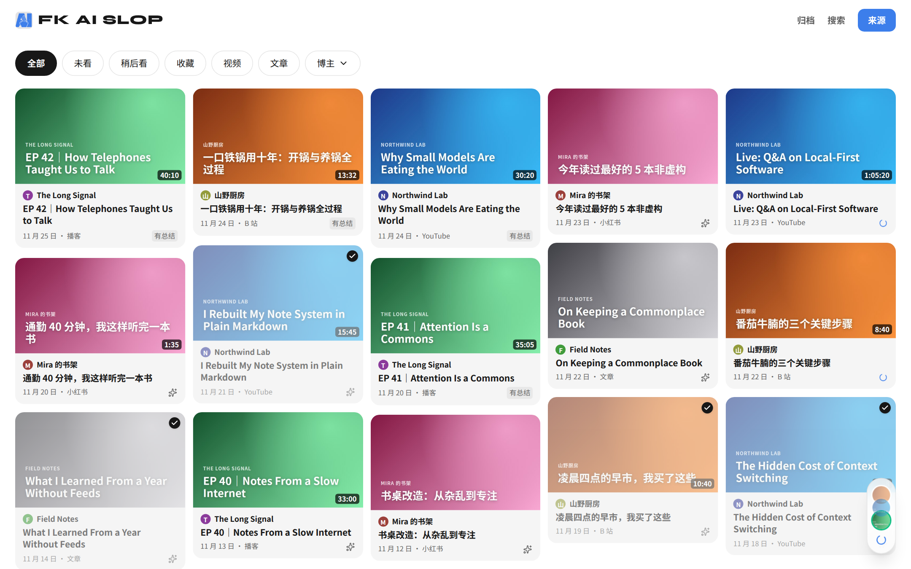
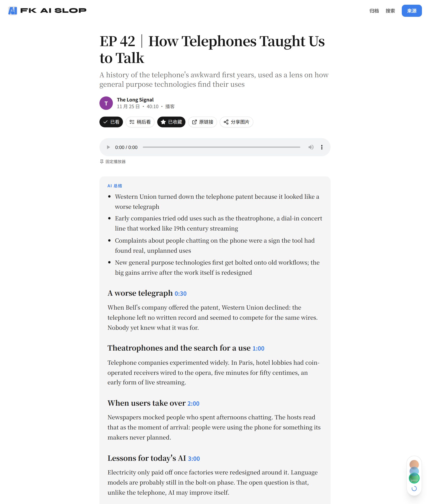
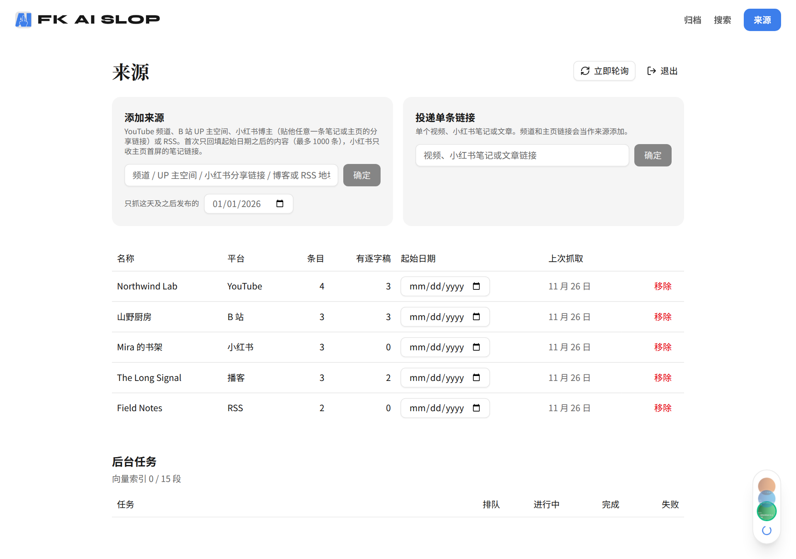
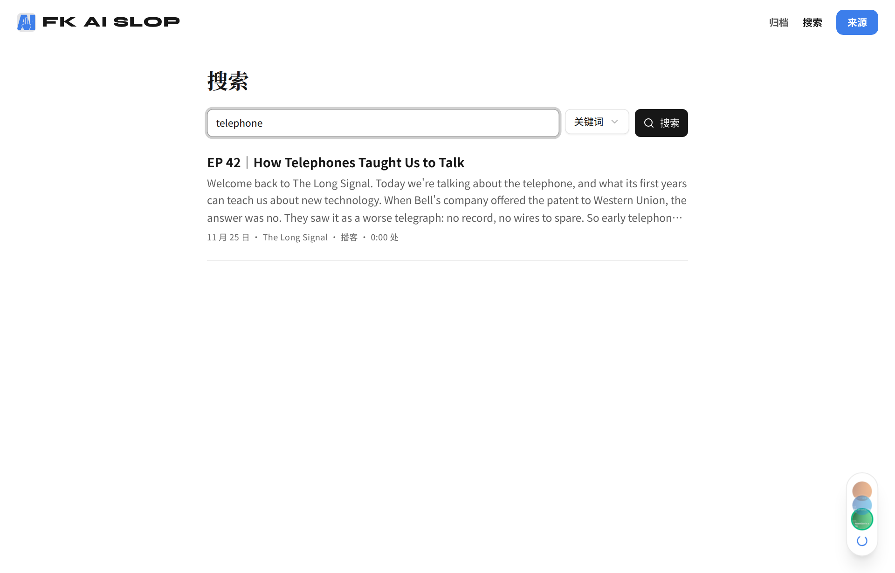

<p align="center">
  
</p>

<h1 align="center">fk ai slop</h1>

<p align="center">
  A self-hosted reading room for the creators you actually chose to follow.<br>
  YouTube, Bilibili, Xiaohongshu, podcasts and blogs in one quiet feed — with transcripts, AI summaries and full-text search.
</p>

<p align="center">
  English · <a href="README.zh-CN.md">简体中文</a>
</p>

<p align="center">
  
</p>

## Why

Recommendation feeds are optimised to keep you scrolling, and more and more of what they surface is filler. fk ai slop goes the other way: you list the people worth your time, it collects everything they publish, turns videos and podcasts into searchable text, and lets you decide in seconds whether something deserves an hour of your attention.

No algorithm, no ads, no engagement metrics. Files on disk are the source of truth, so your archive outlives any platform.

## Features

- **One feed, many platforms** — YouTube channels, Bilibili uploaders, Xiaohongshu profiles, podcasts (any podcast RSS feed) and blogs or newsletters via RSS.
- **Transcripts for everything** — platform subtitles first (including Bilibili AI subtitles), local speech recognition with [SenseVoice](https://github.com/FunAudioLLM/SenseVoice) as a fallback. Every line is timestamped and jumps the player to that moment.
- **AI summaries on demand** — any OpenAI-compatible API (DeepSeek, GLM, Qwen, OpenAI, a local server…). Start one from a feed card without opening the post, and watch progress in a floating panel.
- **Search** — SQLite FTS5 keyword search, plus optional semantic search with Ollama embeddings and sqlite-vec.
- **Reading workflow** — unread / read later / favorites, archive by creator and month, infinite scroll, a subtle sound when a summary lands.
- **Favorites as Markdown** — every favorite is exported to `favorites/` as a plain Markdown file, ready for Obsidian or any notes app.
- **MCP server** — let Claude, Cursor or any MCP client search and read your archive.
- **Graceful degradation** — no LLM, no GPU, no Ollama? The matching buttons simply disappear; everything else still works.

## Screenshots

| Post with timestamped transcript | Summary progress panel |
| --- | --- |
|  |  |

| Sources (admin) | Mobile |
| --- | --- |
|  |  |

<details>
<summary>Search</summary>

</details>

All screenshots use fictional demo data (see [Demo data](#demo-data-and-screenshots)). The interface is currently in Chinese.

## How it works

```
sources ──poll──▶ items (files) ──▶ transcript ──▶ summary
                      │                 │             │
                      └──────── SQLite index (FTS5 + sqlite-vec) ──▶ web UI · search · MCP
```

- `fk serve` runs the FastAPI site, the job workers and the `/mcp` endpoint in one process.
- A systemd timer (or cron) calls `fk poll` to queue new posts from every source.
- Each item lives in its own folder under the data directory (`item.md`, `transcript.json`, `summary.md`, `thumb.jpg`). The SQLite index is disposable: `fk rebuild` recreates it from the files.
- Jobs run in separate lanes (network, ASR, LLM, embeddings) with retries and back-off, so one slow GPU job never blocks the feed.

More detail in [docs/design.md](docs/design.md) (Chinese).

## Quick start

Requirements: Python 3.12+, [uv](https://docs.astral.sh/uv/), Node.js 20+ (to build the frontend; yt-dlp also uses it for YouTube).

```bash
git clone https://github.com/dajiba6/fk-ai-slop.git
cd fk-ai-slop
uv sync
(cd frontend && npm ci && npm run build)

cp .env.example .env
# set ADMIN_KEY to a long random string
uv run fk serve
```

Open <http://127.0.0.1:8090>, click **来源** (Sources), log in with your `ADMIN_KEY` and paste a channel, profile or feed URL. Then queue a poll:

```bash
uv run fk poll
```

### Command line

| Command | What it does |
| --- | --- |
| `fk serve` | Website, background jobs and `/mcp` |
| `fk poll` | Queue a poll of every source (run it from a timer) |
| `fk add-source URL` | Add a source from the shell |
| `fk submit URL` | Archive a single post or video |
| `fk status` | Show the job queue |
| `fk rebuild` | Rebuild the index from files and requeue unfinished jobs |
| `fk favorites` | Regenerate the Markdown files under `favorites/` |
| `fk mcp` | Run the MCP server over stdio |

## Configuration

All settings live in `.env` (see [.env.example](.env.example)). Only `ADMIN_KEY` is needed to get going; each optional block switches a feature on.

| Feature | Settings | Without it |
| --- | --- | --- |
| AI summaries | `FK_LLM_BASE_URL`, `FK_LLM_API_KEY`, `FK_LLM_MODEL` | Summary buttons are hidden |
| Speech recognition | `FK_ASR_PYTHON`, `FK_ASR_DEVICE` | Only videos with subtitles get transcripts |
| Semantic search | `FK_OLLAMA_URL`, `FK_EMBED_MODEL` | Keyword search only |
| Xiaohongshu | `FK_XHS_MCP_URL`, `FK_XHS_COOKIES` | Xiaohongshu links are rejected |
| Members-only YouTube | `FK_YOUTUBE_COOKIES_BROWSER` | Public videos only |
| Proxy | `FK_PROXY`, `FK_DIRECT_PLATFORMS` | Direct connections |

### Speech recognition

ASR runs in a separate Python environment so torch stays out of the main app:

```bash
uv venv ~/.local/opt/asr-venv
uv pip install --python ~/.local/opt/asr-venv/bin/python funasr torch torchaudio
```

Set `FK_ASR_PYTHON=~/.local/opt/asr-venv/bin/python` and `FK_ASR_DEVICE=cuda:0` (or `cpu`). `ffmpeg` must be on `PATH`. The SenseVoiceSmall model is downloaded on first use. Podcasts are transcribed on demand — when you open an episode or ask for a summary.

### Xiaohongshu

Xiaohongshu is read through [xiaohongshu-mcp](https://github.com/xpzouying/xiaohongshu-mcp). Start the container from [deploy/xiaohongshu-mcp](deploy/xiaohongshu-mcp/compose.yml), log in once by scanning the QR code, then set `FK_XHS_MCP_URL` and `FK_XHS_COOKIES`. Backfilling a profile scrolls it in a headless browser, so also run `uv run playwright install chromium`.

## MCP

The archive is exposed as an MCP server with four tools: `search`, `list_items`, `list_sources` and `get_item` (summary, transcript or both).

Over HTTP, from a running `fk serve`:

```json
{
  "mcpServers": {
    "fk-ai-slop": {
      "url": "http://127.0.0.1:8090/mcp",
      "headers": { "Authorization": "Bearer YOUR_ADMIN_KEY" }
    }
  }
}
```

Or over stdio on the same machine: `{"command": "uv", "args": ["--directory", "/path/to/fk-ai-slop", "run", "fk", "mcp"]}`.

## Deployment

[deploy/](deploy) contains systemd user units for the server and the poll timer. Copy them to `~/.config/systemd/user/`, adjust the paths to your checkout, then:

```bash
systemctl --user daemon-reload
systemctl --user enable --now fk-ai-slop.service fk-ai-slop-poll.timer
```

To reach it from outside, put it behind any reverse proxy or tunnel. Visitors can read; only the admin can add sources, request summaries or change state.

## Demo data and screenshots

```bash
uv run python scripts/demo_data.py /tmp/fk-demo
FK_DATA_DIR=/tmp/fk-demo FK_EMBED_MODEL= uv run fk rebuild
FK_DATA_DIR=/tmp/fk-demo FK_EMBED_MODEL= FK_PORT=8097 ADMIN_KEY=demo uv run fk serve
# in another shell
uv run playwright install chromium
uv run python scripts/screenshots.py http://127.0.0.1:8097 demo docs/images
```

## Development

```bash
uv run fk serve                     # backend on :8090
cd frontend && npm run dev          # Vite dev server with hot reload
npm run lint                        # oxlint
```

Backend: FastAPI, SQLite (FTS5 + sqlite-vec), httpx, yt-dlp. Frontend: React 19, TanStack Query, Tailwind CSS 4, lucide icons.

## Disclaimer

This is a personal archiving tool. Respect each platform's terms of service and the creators' copyright, keep polling rates modest, and don't republish content you don't own.

## License

[Apache-2.0](LICENSE)
