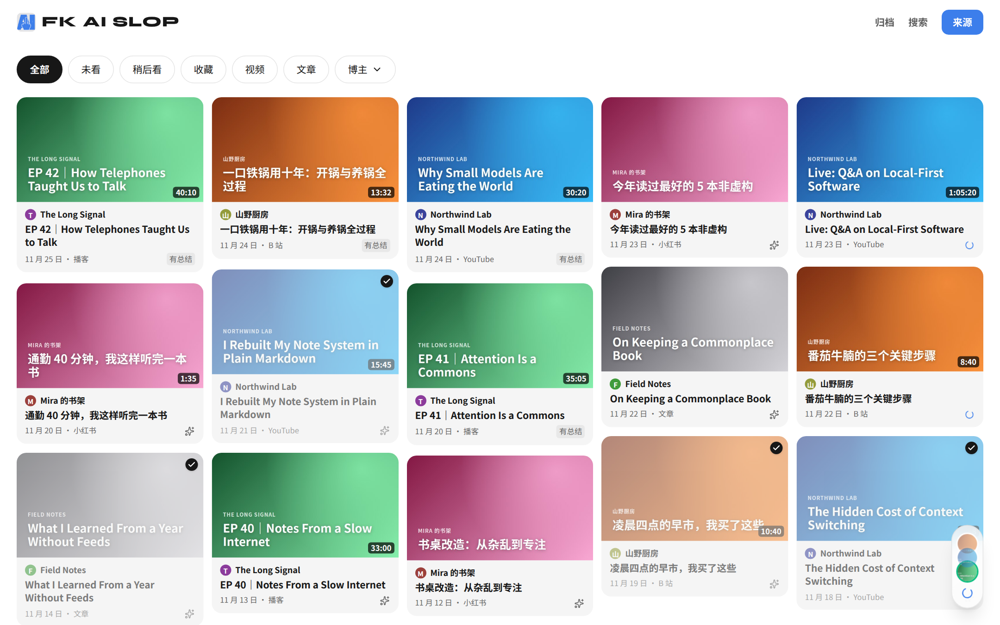
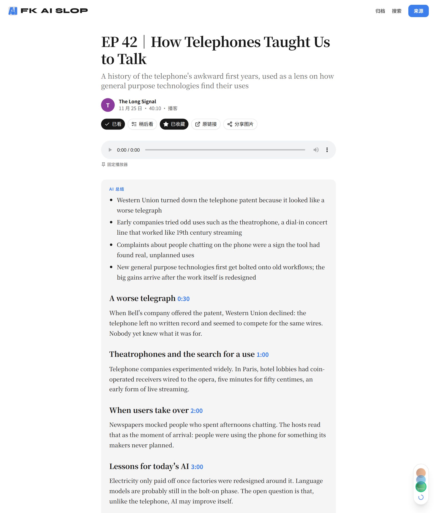
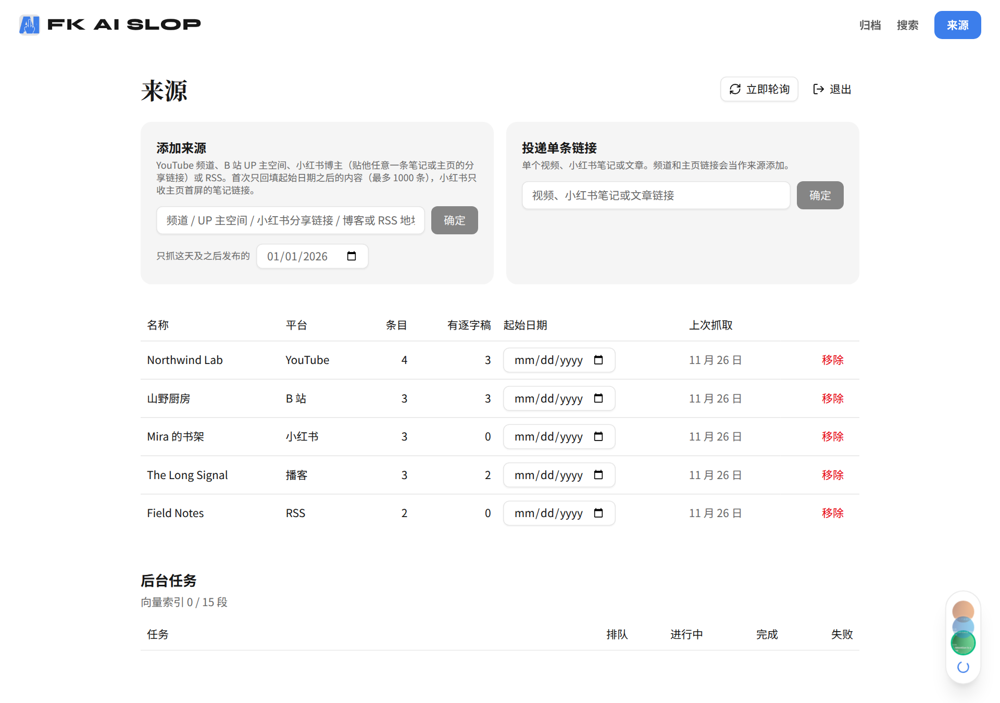
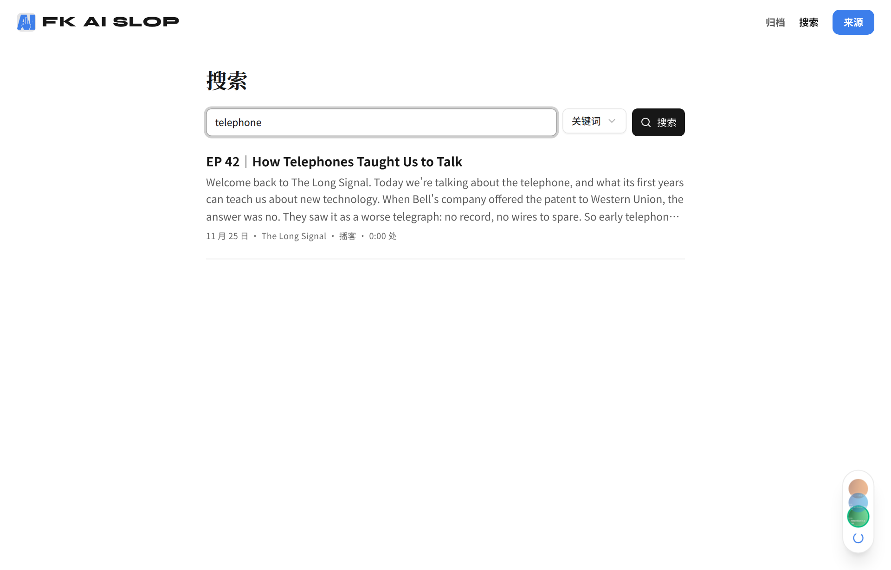

<p align="center">
  
</p>

<h1 align="center">fk ai slop</h1>

<p align="center">
  只看你自己选的创作者的自托管阅读室。<br>
  YouTube、B 站、小红书、播客和博客汇成一个安静的信息流，自带字幕转写、AI 总结和全文搜索。
</p>

<p align="center">
  <a href="README.md">English</a> · 简体中文
</p>

<p align="center">
  
</p>

## 为什么做这个

推荐流的目标是让你一直刷下去，推上来的东西里水货也越来越多。fk ai slop 反过来：你列出值得花时间的人，它把这些人发布的内容全部收下来，把视频和播客变成可搜索的文字，让你几秒钟就能判断一条内容值不值得花一小时去看。

没有算法，没有广告，没有互动数据。磁盘上的文件就是唯一的真实来源，平台没了，你的存档还在。

## 功能

- **一个信息流，多个平台**：YouTube 频道、B 站 UP 主、小红书主页、播客（任意播客 RSS）以及通过 RSS 订阅的博客和 Newsletter。
- **所有内容都有文字稿**：优先使用平台字幕（包括 B 站 AI 字幕），没有字幕时用本地 [SenseVoice](https://github.com/FunAudioLLM/SenseVoice) 语音识别。每一句都带时间戳，点击即可跳到播放器对应位置。
- **按需 AI 总结**：支持任何 OpenAI 兼容接口（DeepSeek、GLM、通义千问、OpenAI、本地模型……）。在首页卡片上一键开始，不用点进帖子；右侧悬浮面板实时显示进度。
- **搜索**：SQLite FTS5 关键词搜索，可选用 Ollama 向量 + sqlite-vec 做语义搜索。
- **阅读流程**：未看 / 稍后看 / 收藏，按创作者和月份归档，无限滚动，总结完成时有轻提示音。
- **收藏导出 Markdown**：每条收藏都会导出为 `favorites/` 下的独立 Markdown 文件，可以直接放进 Obsidian 或任何笔记软件。
- **MCP 服务**：让 Claude、Cursor 或任何 MCP 客户端检索和阅读你的存档。
- **缺什么就关什么**：没有大模型、没有 GPU、没有 Ollama？对应的按钮会自动隐藏，其他功能照常使用。

## 截图

| 带时间戳文字稿的帖子页 | AI 总结进度面板 |
| --- | --- |
|  |  |

| 来源管理（管理员） | 手机端 |
| --- | --- |
|  |  |

<details>
<summary>搜索</summary>

</details>

截图全部使用虚构的演示数据（见[演示数据与截图](#演示数据与截图)）。

## 工作原理

```
来源 ──轮询──▶ 条目（文件） ──▶ 文字稿 ──▶ 总结
                  │              │          │
                  └───── SQLite 索引（FTS5 + sqlite-vec） ──▶ 网页 · 搜索 · MCP
```

- `fk serve` 在一个进程里运行 FastAPI 网站、后台任务和 `/mcp` 接口。
- systemd 定时器（或 cron）调用 `fk poll`，为每个来源排队拉取新内容。
- 每个条目在数据目录下有自己的文件夹（`item.md`、`transcript.json`、`summary.md`、`thumb.jpg`）。SQLite 索引可以随时删掉，`fk rebuild` 会从文件重建。
- 任务按通道（网络、语音识别、大模型、向量）分开执行，带重试和退避，一个慢的 GPU 任务不会卡住整个信息流。

更多细节见 [docs/design.md](docs/design.md)。

## 快速开始

需要：Python 3.12+、[uv](https://docs.astral.sh/uv/)、Node.js 20+（用于构建前端，yt-dlp 抓 YouTube 时也会用到）。

```bash
git clone https://github.com/dajiba6/fk-ai-slop.git
cd fk-ai-slop
uv sync
(cd frontend && npm ci && npm run build)

cp .env.example .env
# 把 ADMIN_KEY 设成一串足够长的随机字符
uv run fk serve
```

打开 <http://127.0.0.1:8090>，点 **来源**，用 `ADMIN_KEY` 登录，然后粘贴频道、主页或 RSS 链接。接着排队一次轮询：

```bash
uv run fk poll
```

### 命令行

| 命令 | 作用 |
| --- | --- |
| `fk serve` | 网站、后台任务和 `/mcp` |
| `fk poll` | 为所有来源排队一次轮询（交给定时器调用） |
| `fk add-source URL` | 在命令行添加来源 |
| `fk submit URL` | 存档单条帖子或视频 |
| `fk status` | 查看任务队列 |
| `fk rebuild` | 从文件重建索引，并重新排队未完成的任务 |
| `fk favorites` | 重新生成 `favorites/` 下的 Markdown |
| `fk mcp` | 以 stdio 方式运行 MCP |

## 配置

所有配置都在 `.env` 里（参考 [.env.example](.env.example)）。只有 `ADMIN_KEY` 是必须的，其余每一组配置打开一项功能。

| 功能 | 配置项 | 不配置时 |
| --- | --- | --- |
| AI 总结 | `FK_LLM_BASE_URL`、`FK_LLM_API_KEY`、`FK_LLM_MODEL` | 隐藏总结按钮 |
| 语音识别 | `FK_ASR_PYTHON`、`FK_ASR_DEVICE` | 只有带字幕的视频有文字稿 |
| 语义搜索 | `FK_OLLAMA_URL`、`FK_EMBED_MODEL` | 只用关键词搜索 |
| 小红书 | `FK_XHS_MCP_URL`、`FK_XHS_COOKIES` | 不接受小红书链接 |
| YouTube 会员视频 | `FK_YOUTUBE_COOKIES_BROWSER` | 只抓公开视频 |
| 代理 | `FK_PROXY`、`FK_DIRECT_PLATFORMS` | 直连 |

### 语音识别

语音识别跑在单独的 Python 环境里，避免把 torch 装进主程序：

```bash
uv venv ~/.local/opt/asr-venv
uv pip install --python ~/.local/opt/asr-venv/bin/python funasr torch torchaudio
```

然后设置 `FK_ASR_PYTHON=~/.local/opt/asr-venv/bin/python` 和 `FK_ASR_DEVICE=cuda:0`（或 `cpu`）。`ffmpeg` 需要在 `PATH` 里。SenseVoiceSmall 模型会在第一次使用时自动下载。播客按需转写：打开单集或请求总结时才会开始。

### 小红书

小红书通过 [xiaohongshu-mcp](https://github.com/xpzouying/xiaohongshu-mcp) 读取。用 [deploy/xiaohongshu-mcp](deploy/xiaohongshu-mcp/compose.yml) 启动容器，扫码登录一次，再设置 `FK_XHS_MCP_URL` 和 `FK_XHS_COOKIES`。回填主页历史内容时会用无头浏览器滚动页面，所以还需要运行 `uv run playwright install chromium`。

## MCP

存档以 MCP 服务的形式提供四个工具：`search`、`list_items`、`list_sources` 和 `get_item`（可取总结、文字稿或全部）。

通过 HTTP 连接正在运行的 `fk serve`：

```json
{
  "mcpServers": {
    "fk-ai-slop": {
      "url": "http://127.0.0.1:8090/mcp",
      "headers": { "Authorization": "Bearer YOUR_ADMIN_KEY" }
    }
  }
}
```

或者在同一台机器上用 stdio：`{"command": "uv", "args": ["--directory", "/path/to/fk-ai-slop", "run", "fk", "mcp"]}`。

## 部署

[deploy/](deploy) 里有网站和轮询定时器的 systemd 用户单元。复制到 `~/.config/systemd/user/`，把路径改成你的代码目录，然后：

```bash
systemctl --user daemon-reload
systemctl --user enable --now fk-ai-slop.service fk-ai-slop-poll.timer
```

需要外网访问时，放在任意反向代理或内网穿透后面即可。访客只能阅读；添加来源、请求总结、修改状态都需要管理员登录。

## 演示数据与截图

```bash
uv run python scripts/demo_data.py /tmp/fk-demo
FK_DATA_DIR=/tmp/fk-demo FK_EMBED_MODEL= uv run fk rebuild
FK_DATA_DIR=/tmp/fk-demo FK_EMBED_MODEL= FK_PORT=8097 ADMIN_KEY=demo uv run fk serve
# 另开一个终端
uv run playwright install chromium
uv run python scripts/screenshots.py http://127.0.0.1:8097 demo docs/images
```

## 开发

```bash
uv run fk serve                     # 后端，端口 8090
cd frontend && npm run dev          # Vite 开发服务器，支持热更新
npm run lint                        # oxlint
```

后端：FastAPI、SQLite（FTS5 + sqlite-vec）、httpx、yt-dlp。前端：React 19、TanStack Query、Tailwind CSS 4、lucide 图标。

## 免责声明

这是一个个人存档工具。请遵守各平台的服务条款，尊重创作者的版权，保持适度的轮询频率，不要转载不属于你的内容。

## 许可证

[Apache-2.0](LICENSE)
